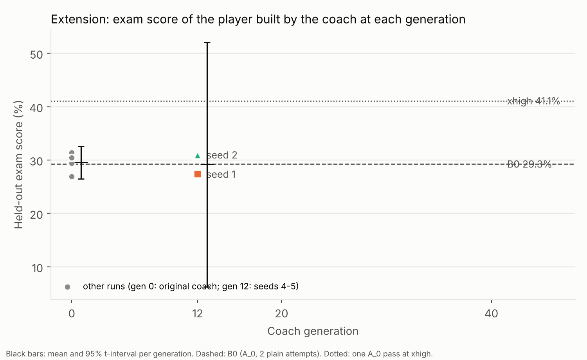

# RESULTS

## Headline

**Neither improver beat two plain attempts on ARC-AGI-2**

## Main estimates (held-out ARC-AGI-2 public evaluation, 120 tasks, 167 test inputs)

- B0 (A_0, two plain attempts): 29.3% (reps: 30.1%, 27.9%, 29.7%)
- **G** (I_0-built agents minus B0): +0.3 points, 95% Welch CI [-2.7, +3.3] (df 4.9)
- **Delta** (evolved-improver agents minus I_0-built agents): -0.4 points, 95% Welch CI [-11.7, +10.9] (df 1.6)
- Evolved arm gain over B0: -0.1 points, 95% Welch CI [-14.7, +14.5] (df 1.3)
- Qualifying evolved improvers: 5 of 6 source seeds

## Per-run held-out scores

| run | arm | seed | final node | held-out | accepted candidates in run |
|---|---|---|---|---|---|
| payoff_I0_1 | I0 | r1 | 4 | 26.9% | 6 |
| payoff_I0_2 | I0 | r2 | 4 | 29.4% | 7 |
| payoff_I0_3 | I0 | r3 | 3 | 30.4% | 5 |
| payoff_I0_5 | I0 | r5 | 3 | 31.4% | 3 |
| payoff_Ig_source_s2 | Ig | 2 | 3 | 27.4% | 5 |
| payoff_Ig_source_s3 | Ig | 3 | 1 | 31.0% | 2 |

Run-to-run SD: B0 1.2%, I_0 arm 1.9%, evolved arm 2.6%.

## Secondary results

- One held-out pass of A_0 at xhigh effort: 0.4111 (same 30-min per-test-input wall-clock limit; many xhigh inputs hit it).
- Self-edit rate in source runs: 21 of 72 generations changed meta-agent code; 15 of those became parents.
  - source_s1: 1/12 self-edits, 1 became parents
  - source_s2: 4/12 self-edits, 3 became parents
  - source_s3: 5/12 self-edits, 3 became parents
  - source_s4: 1/12 self-edits, 0 became parents
  - source_s5: 7/12 self-edits, 5 became parents
  - source_s6: 3/12 self-edits, 3 became parents
- Selected evolved improvers (I_g):
  - source_s1: gen 1, 1 children (1 scored), mean child improvement +12.0 pts, meta files changed vs I_0: meta_agent.py; meta edits in ancestry at generations [1]
  - source_s2: gen 5, 2 children (2 scored), mean child improvement -4.0 pts, meta files changed vs I_0: meta_agent.py; meta edits in ancestry at generations [5]
  - source_s3: gen 3, 1 children (1 scored), mean child improvement +0.0 pts, meta files changed vs I_0: meta_agent.py; meta edits in ancestry at generations [3]
  - source_s4: no qualifying agent (no meta-code change with a scored child) - no pay-off run
  - source_s5: gen 6, 1 children (1 scored), mean child improvement +8.0 pts, meta files changed vs I_0: meta_agent.py; meta edits in ancestry at generations [6]
  - source_s6: gen 4, 3 children (1 scored), mean child improvement -4.0 pts, meta files changed vs I_0: utils/git_utils.py; meta edits in ancestry at generations [4]
- Tokens, arm I0: 27048 task-agent tokens per task evaluation (825 evaluations); 349804 meta tokens per iteration (48 iterations)
- Tokens, arm Ig: 23510 task-agent tokens per task evaluation (550 evaluations); 187914 meta tokens per iteration (40 iterations)

## Spend by role (USD, ledger)

- meta: $3.14
- probe: $0.00
- task: $102.15
- **total: $105.29** (hard stop at $150)

## Crashes, aborts and reruns

- payoff_I0_1__harness_nonce_bug (see DECISIONS.md)
- payoff_I0_2__harness_nonce_bug (see DECISIONS.md)
- payoff_I0_2__sanitizer_dropped_gitignore_patch_gen7 (see DECISIONS.md)
- infra abort (resumed) in payoff_I0_4 at gen 6: gateway restarted or global budget refusal during meta step
- infra abort (resumed) in payoff_I0_6 at gen 6: gateway restarted or global budget refusal during meta step
- infra abort (resumed) in payoff_Ig_source_s6 at gen 8: gateway restarted or global budget refusal during meta step
- infra abort (resumed) in source_s2 at gen 18: upstream errors during meta step (rc=0, patch=False)
- infra abort (resumed) in source_s3 at gen 15: upstream errors during meta step (rc=0, patch=False)
- infra abort (resumed) in source_s3 at gen 15: upstream errors during meta step (rc=0, patch=False)
- infra abort (resumed) in source_s4 at gen 19: gateway restarted or global budget refusal during meta step

## Timeouts per arm (rollouts that hit the per-test-input wall-clock limit)

| arm / phase | rollouts | timeouts |
|---|---|---|
| b0 / A0 | 501 | 0 |
| ext_payoff / g20 | 272 | 0 |
| heldout / I0 | 852 | 0 |
| heldout / Ig | 829 | 0 |
| heldout / g20 | 91 | 0 |
| initial / A0 | 221 | 0 |
| payoff / I0 | 1079 | 0 |
| payoff / Ig | 572 | 0 |
| rescore / I0 | 312 | 0 |
| rescore / Ig | 260 | 0 |
| rescore / g20 | 133 | 0 |
| screen / A0 | 309 | 0 |
| smoke / I0 | 13 | 0 |
| source / I0src | 2440 | 1 |
| trial / Ig | 78 | 0 |
| xhigh / A0 | 167 | 0 |

49 rollouts that hit an earlier (30-min) limit were invalidated and re-run under the 3 h limit.

## Model and reasoning effort actually used

- Model string returned by the API: `gpt-6-luna` (18741 calls); calls from 2026-11-17 to 2026-11-18.
- Effort echoed by the API, by role: meta=high: 2475, probe=high: 2, task=high: 15874, task=xhigh: 390.

# EXTENSION (DESIGN_v2.md, not pre-registered in f577cc7)

Does the coach get better at coaching over generations? Exam score of the player each coach builds, by coach generation.



| generation | runs | mean | 95% t-interval | scores |
|---|---|---|---|---|
| 0 | 4 | 29.5% | [26.5%, 32.6%] | 26.9%, 29.4%, 31.4%, 30.4% |
| 12 | 2 | 29.2% | [6.2%, 52.1%] | 27.4%, 31.0% |
- Paired change 12->20 (seeds 0-3): n/a
- Paired change 20->40 (seeds 0-3): n/a
- Picks with changed coach code: generation 12 (part A rule) 5 of 6 seeds; extension 9 of 9 ({'source_s1:g6': 1, 'source_s2:g6': 5, 'source_s3:g6': 3, 'source_s4:g6': 6, 'source_s4:g20': 12, 'source_s2:g20': 9, 'source_s3:g20': 9, 'source_s1:g20': 1, 'source_s4:g30': 15}).

## Diff audit of every picked coach (each changed hunk vs I_0; 2 independent judges + tiebreak)

| pick | file | hunk | tag | agreement |
|---|---|---|---|---|
| A_gen12:source_s1 | meta_agent.py | 0 | general | unanimous |
| A_gen12:source_s2 | meta_agent.py | 0 | general | unanimous |
| A_gen12:source_s2 | meta_agent.py | 1 | general | unanimous |
| A_gen12:source_s3 | meta_agent.py | 0 | ARC-specific | unanimous |
| A_gen12:source_s5 | meta_agent.py | 0 | general | unanimous |
| A_gen12:source_s6 | utils/git_utils.py | 0 | general | unanimous |
| A_gen12:source_s6 | utils/git_utils.py | 1 | general | unanimous |

1 of 7 hunks ARC-specific, 6 general. Reasons in exp/results/diff_audit.json.

## Deviations from f577cc7 and DESIGN_v2.md

Every deviation and harness fix is numbered in DECISIONS.md (items marked DEVIATION; harness bugs and reruns at 23, 24, 26, 28, 33, 35).

## analysis.py output

```
HEADLINE: Neither improver beat two plain attempts on ARC-AGI-2
B0 = 29.3% (reps: 30.1%, 27.9%, 29.7%)
G                +0.3 pts  95% CI [-2.7, +3.3]  df=4.9
Delta            -0.4 pts  95% CI [-11.7, +10.9]  df=1.6
I0_gain_over_B0  +0.3 pts  95% CI [-2.7, +3.3]  df=4.9
Ig_gain_over_B0  -0.1 pts  95% CI [-14.7, +14.5]  df=1.3

| run | arm | seed | final node | held-out |
|---|---|---|---|---|
| payoff_I0_1 | I0 | r1 | 4 | 26.9% |
| payoff_I0_2 | I0 | r2 | 4 | 29.4% |
| payoff_I0_3 | I0 | r3 | 3 | 30.4% |
| payoff_I0_5 | I0 | r5 | 3 | 31.4% |
| payoff_Ig_source_s2 | Ig | 2 | 3 | 27.4% |
| payoff_Ig_source_s3 | Ig | 3 | 1 | 31.0% |

run-to-run SD: {'B0': '1.2%', 'I0': '1.9%', 'Ig': '2.6%'}
self-edit: {'source_s1': {'gens': 12, 'self_edit_gens': 1, 'self_edit_parents': 1}, 'source_s2': {'gens': 12, 'self_edit_gens': 4, 'self_edit_parents': 3}, 'source_s3': {'gens': 12, 'self_edit_gens': 5, 'self_edit_parents': 3}, 'source_s4': {'gens': 12, 'self_edit_gens': 1, 'self_edit_parents': 0}, 'source_s5': {'gens': 12, 'self_edit_gens': 7, 'self_edit_parents': 5}, 'source_s6': {'gens': 12, 'self_edit_gens': 3, 'self_edit_parents': 3}} rate 0.2916666666666667
tokens by arm: {'I0': {'task_tokens_per_task_eval': 27048.02303030303, 'meta_tokens_per_iteration': 349804.3333333333, 'n_task_evals': 825, 'n_meta_iterations': 48}, 'Ig': {'task_tokens_per_task_eval': 23510.296363636364, 'meta_tokens_per_iteration': 187913.875, 'n_task_evals': 550, 'n_meta_iterations': 40}}
spend by role: {'probe': 0.0, 'task': 102.155, 'meta': 3.14} total 105.295
```
