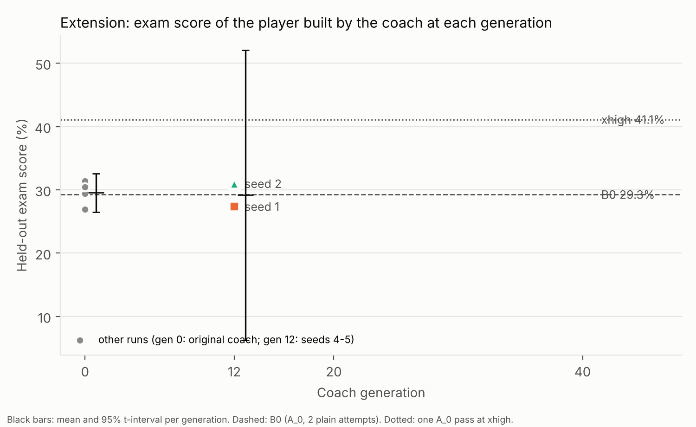

# Does a self-improving coach get better at coaching? A test on ARC-AGI-2

**TL;DR.** On the pre-registered test, players built by the original coach scored no better on a held-out ARC-AGI-2 exam than a player that simply asks the model twice (29.3%), and players built by self-evolved coaches scored 1.8 points lower than the original coach's players (95% interval -4.2 to +0.6, so no clear difference). In a follow-up that was not pre-registered, coaches taken from later in evolution (up to generation 40) built players that scored about the same as the original coach's players (+0.6 points, 95% interval -6.5 to +7.8). Several of those "later" coaches were the same code as earlier ones, so this is weak evidence either way. The whole study cost $152.23 in model calls.

## The question

This repo has two LLM agents. The **coach** (the repo's *meta agent*) reads results and edits code. The **player** (the repo's *task agent*) solves ARC puzzles. The coach can edit the player, and it can also edit itself. The idea is that a coach that rewrites itself might become a better coach. We asked: if you take a coach that has evolved itself and give it the same budget as the original coach, does it build a better player? An extension then asked whether coaches from later generations do better than coaches from earlier ones.

## How we tested it

1. **Puzzles.** ARC-AGI-2: small coloured-grid puzzles where you must infer a rule from a few examples. The **exam** is all 120 public evaluation tasks (167 test inputs). No coach ever saw it.
2. **Practice sets.** Two disjoint sets of 25 training tasks: a *source* set (where coaches evolve) and a *pay-off* set (where coaches are tested). Each set has 19 tasks the starting player solves sometimes but not always, plus 3 it always solves and 3 it never solves (too few intermediate tasks qualified to fill both sets).
3. **Budget.** Every player gets at most 2 model calls and 2 answers per test input. A puzzle input counts as solved if either answer is exactly right. Model: `gpt-6-luna` at reasoning effort `high` (effort is an API setting for how long the model thinks before it answers; `xhigh` is the next level up). A separate budget process fixes the model and effort, so no coach can change them.
4. **Starting player A_0.** It just asks the model for the answer twice. Its exam score is **B0** (measured 3 times).
5. **Source runs.** Starting from the original coach (I_0), the repo's own evolution loop ran for 12 generations on the source set, 6 times (runs `source_s1` to `source_s6`). Each generation, the coach edits the code, including possibly its own code.
6. **Picking the evolved coach (I_g).** In each source run, among coaches whose code differs from I_0 and that produced at least one scored child, take the one whose children improved most. 5 of 6 runs had one.
7. **Pay-off runs.** Each coach gets A_0 and 8 rounds on the pay-off set, with its own code frozen. So it can only improve the player. Six runs used I_0; five used an I_g.
8. **Final exam.** In each run, the two players with the best pay-off-set scores are re-scored on that set. The one with the higher mean of its loop score and re-score takes the exam once. The unedited A_0 is eligible. In one run (`source_s4` at generation 20) it won, so that exam score is A_0's own.

## Results: the pre-registered experiment

Pre-registered headline: **"Neither improver beat two plain attempts on ARC-AGI-2."**

| run | coach | exam score |
|---|---|---|
| B0 rep 0 / 1 / 2 | none (A_0) | 30.1% / 27.9% / 29.7% (mean 29.3%) |
| A_0 at xhigh effort (one pass) | none | 41.1% |
| payoff_I0_1 | original | 26.9% |
| payoff_I0_2 | original | 29.4% |
| payoff_I0_3 | original | 30.4% |
| payoff_I0_4 | original | 30.4% |
| payoff_I0_5 | original | 31.4% |
| payoff_I0_6 | original | 29.4% |
| payoff_Ig_source_s1 | evolved (from source_s1; coach created at generation 1) | 26.0% |
| payoff_Ig_source_s2 | evolved (from source_s2; coach created at generation 5) | 27.4% |
| payoff_Ig_source_s3 | evolved (from source_s3; coach created at generation 3) | 31.0% |
| payoff_Ig_source_s5 | evolved (from source_s5; coach created at generation 6) | 27.2% |
| payoff_Ig_source_s6 | evolved (from source_s6; coach created at generation 4) | 27.9% |

`source_s4` had no qualifying evolved coach, so it had no pay-off run.

Intervals are 95% Welch intervals: a standard confidence interval for the difference of two group means that does not assume equal spread. If an interval contains 0, the data cannot tell the difference from no effect.

| estimate | value | 95% Welch interval |
|---|---|---|
| **G** = original-coach players minus B0 | +0.4 points | [-1.9, +2.8] |
| **Delta** = evolved-coach players minus original-coach players | -1.8 points | [-4.2, +0.6] |
| Evolved-coach players minus B0 | -1.4 points | [-4.0, +1.3] |

Run-to-run standard deviation: B0 1.2, original-coach runs 1.5, evolved-coach runs 1.9 points.

In plain terms: every interval includes zero, so we found no evidence that either coach helped, and no evidence that evolving the coach helped or hurt. For reference, a single pass of A_0 at xhigh effort scored 41.1%. The model can do much better with more thinking per call, but effort was locked at high for every player, so this gain was not available to any coach.

## Results: the extension (does the coach improve over generations?)

This part was planned after the main result (DESIGN_v2.md), not pre-registered. Source runs `source_s1` to `source_s4` were continued to 40 generations. "The coach at generation g" means the coach picked from a run's saved versions as they stood after g generations; it may have been created much earlier. For generations 20 and 40 the rule was: among changed coaches with at least 3 descendants, take the one whose children improved most; if none has 3, take the changed coach with the most descendants. Each picked coach was then tested exactly like a pay-off run. Coaches were also picked at generations 6 and 30, but those were only stored, not tested. Generation 0 is the six original-coach runs. Generation 12 is the five evolved-coach runs above, which include `source_s5` and `source_s6` (not continued) and lack `source_s4` (no qualifying coach). So generation 12 is not the same set of runs as 20 and 40.

| generation | runs | mean | 95% interval | scores |
|---|---|---|---|---|
| 0 | 6 | 29.7% | [28.1%, 31.3%] | 26.9, 29.4, 31.4, 30.4, 30.4, 29.4 |
| 12 | 5 | 27.9% | [25.6%, 30.2%] | 27.4, 31.0, 27.2, 26.0, 27.9 |
| 20 | 4 | 29.8% | [26.2%, 33.3%] | 27.9, 31.5, 31.8, 27.8 |
| 40 | 4 | 30.3% | [22.9%, 37.7%] | 28.9, 24.9, 31.5, 36.0 |

**Generation 40 minus generation 0: +0.6 points, 95% Welch interval [-6.5, +7.8]. The interval is wide and includes 0, so there is no detectable trend.**

Paired changes for the same source run: 12 to 20 was +1.8, +4.2, +0.8 (`source_s1` to `source_s3`; `source_s4` had no generation-12 coach), mean +2.3. 20 to 40 was +8.2, +0.0, -6.9, +1.0 (`source_s1` to `source_s4`), mean +0.6.

**Caveat: often the "later" coach is the same coach.** The pick rule often chose the same coach node (a node is one saved version of the code in a run's archive) at several generations (DECISIONS 37). `source_s1` picked node 1 at generations 12, 20 and 40. `source_s3` picked node 9 at 20 and 40. `source_s2` picked node 5 at 12 and 40 (node 9 at 20), so its 12-to-40 comparison is one fixed coach re-run. For `source_s1` (all generations) and `source_s3` (20 to 40), the reported paired changes are just the noise of re-running one fixed coach. `source_s1`'s identical coach scored 26.0%, 27.8% and 36.0%, a spread of about 10 points. So no trend can be separated from that noise.

**Pick rule check.** At generation 12, the extension rule and the committed rule pick the same coach for `source_s1`, `source_s2` and `source_s3`. For `source_s4` the committed rule picks none, while the extension rule falls back to node 6, a coach with 0 descendants. So the two rules agree wherever both pick a coach. The only difference is that the extension rule will pick a barely tested coach when nothing better exists.

## What the evolved coaches actually changed

- **Self-edits were uncommon.** In the first 12 generations, 21 of 72 generations (29%) changed coach code, and 15 of those changed coaches were later chosen as the starting point for a further edit. By run (`source_s1` to `source_s6`): 1, 4, 5, 1, 7 and 3 of 12.
- **Diff audit.** All 21 picked coaches (5 from the main test, 16 from the extension at generations 6, 20, 30 and 40) were compared with I_0. Every changed piece ("hunk") was tagged by two independent judges as ARC-specific or general. All tags were unanimous. 3 of 32 hunks were ARC-specific:
  - The `source_s3` coach (node 3, picked both by the main rule and as the extension's generation-6 pick) wrote this run's own scores into its prompt ("gen_1 scored 0.96, while gen_2 scored 0.84...") and warned against "hardcoded colors, shapes, or grid dimensions". These are two of the three hunks, but they are the same coach code.
  - The `source_s4` coach picked at generation 30 pointed the coach at the `arc_eval` log folder and used this harness's prediction fields. This coach was stored but not tested.
- **Most edits were bookkeeping and advice.** Typical changes added a helper that reads past evaluation reports, lists failed tasks, and flags regressions. They also added prompt text like "be evidence-driven, compare with the parent, make one focused change, don't hard-code answers". A few were plumbing: one fixed the git diff helper to skip bytecode files; one made the bash tool keep a persistent shell.

## Caveats and what went wrong

- **The original coach needed adapting (DECISIONS 14, 15).** With the repo's verbatim instruction, the model only asked clarifying questions and never edited code. One sentence was added (work autonomously) and tool-call parsing was loosened. Both groups started from this adapted coach.
- **The original coach often made no edit (DECISIONS 27).** It ended 11 of its first 31 coaching steps without an edit, mostly from tool-call format problems. Left unchanged, as pre-registered.
- **Harness bugs (DECISIONS 23, 24).** One bug broke the first two original-coach pay-off runs (the "pilot") before any coach ran; both restarted with new seeds. Another discarded coach edits that created a `.gitignore` file: payoff_I0_2 was restarted a second time; source_s6 kept its run, losing one of 12 generations.
- **Some coach edits broke the player (DECISIONS 32),** e.g. passing an argument the function did not accept, scoring 0. These count as real outcomes.
- **Time limit (DECISIONS 26, 29).** A 30-minute limit per test input killed 49 B0 and xhigh inputs. All were re-run under a 2-3 h limit; no final score includes a timeout. The final xhigh score is 41.1% (39.9% before the re-runs).
- **Infrastructure (DECISIONS 28, 35, 39).** 6 VM restarts and some dropped network calls; all runs resumed, only in-flight work redone, no result lost. Streaming changed only the transport. Since DECISIONS 35, a call still refused by the provider's safety filter after two retries counts as the caller's failed call, not an infrastructure retry.
- **Timing (DECISIONS 22, 31).** Some steps started before earlier ones finished (e.g. pay-off runs began before the pilot exams were scored). No result from one step chose anything in another.
- **Small samples and noise.** 6, 5, 4 and 4 runs per group. One fixed coach varied by about 10 points across re-runs.

## Cost

| role | spend (USD) |
|---|---|
| player (task) | $148.03 |
| coach (meta) | $4.19 |
| probe | $0.00 |
| **total** | **$152.23** |

The original hard stop was $150 (DESIGN.md). The user raised it to $200 before the extension. Players are cheap per call but make many calls; coaches used about 350k tokens per round in the original-coach runs and about 188k in the evolved-coach runs.

## Where to find things

- `RESULTS.md`: all numbers, with the analysis output.
- `DESIGN.md` (pre-registered, commit f577cc7) and `DESIGN_v2.md` (extension plan).
- `DECISIONS.md`: every deviation, bug and rerun, numbered.
- `exp/results/analysis.json`, `exp/results/ext_analysis.json`: computed estimates.
- `exp/results/final_runs.jsonl`: exam score per run.
- `exp/results/diff_audit.json`: hunk-by-hunk audit with judges' reasons.
- `exp/results/pick_rule_comparison_g12.json`, `exp/results/ig_selection.json`, `exp/results/ext_picks.json`: which coach was picked and why.
- `exp/results/extension_plot.png`: the extension figure.
